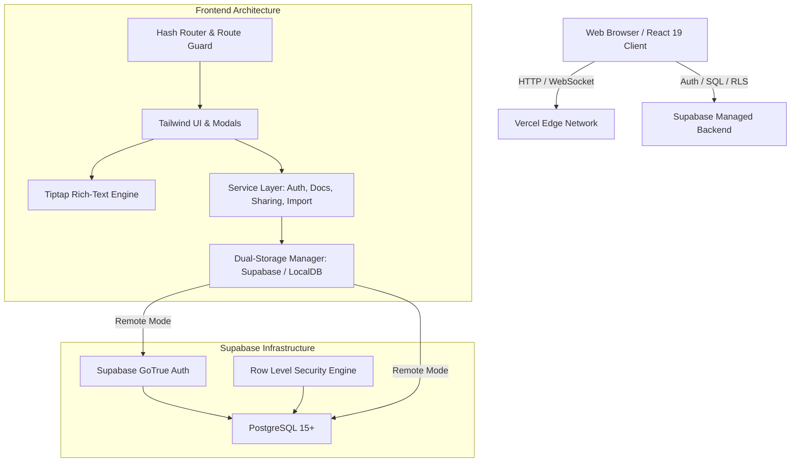
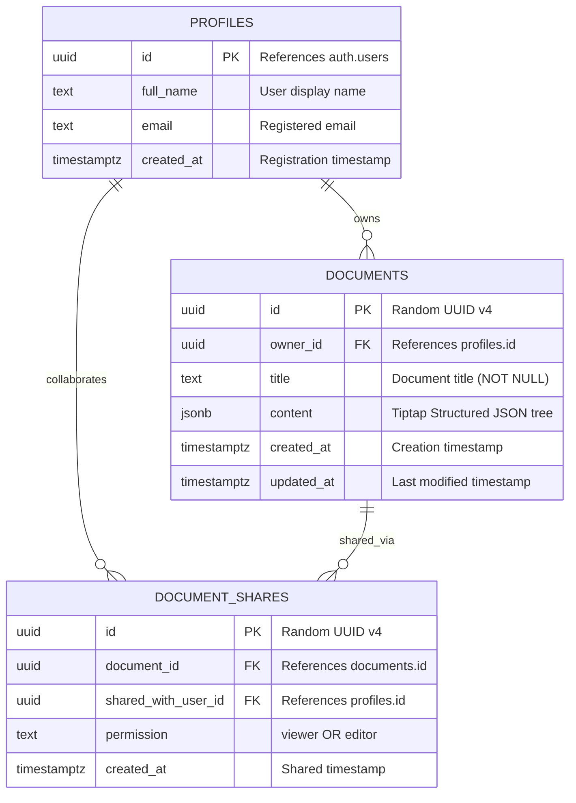
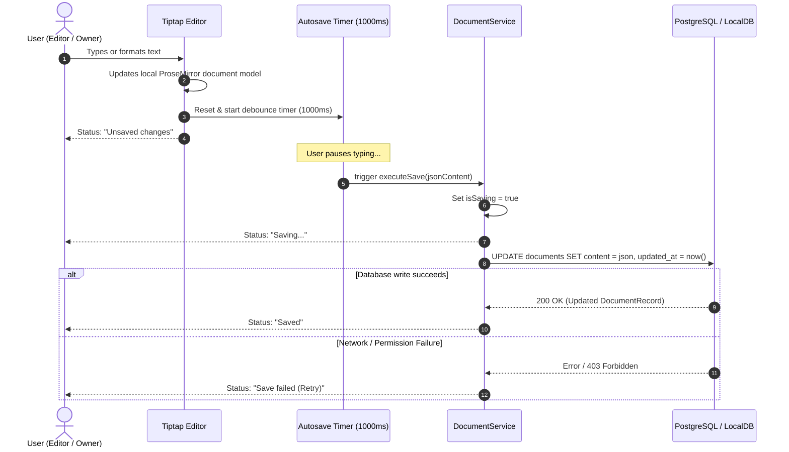
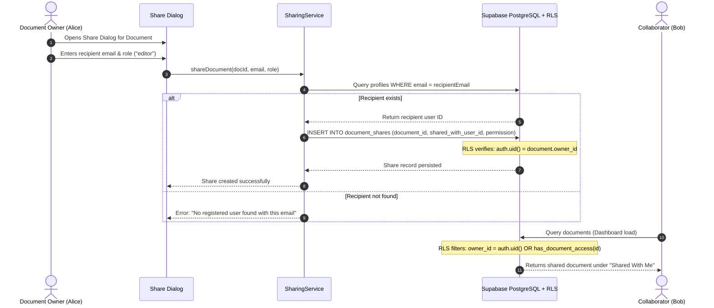

# CollabDocs — Architectural Specification

> **Ajaia LLC — AI-Native Full Stack Developer Assessment**  
> **Candidate:** Abduljawwad Salihu  
> **Document Status:** Approved Architecture  

---

## 1. System Overview

CollabDocs is an enterprise-grade, lightweight collaborative document editing and management platform. It combines a modern headless rich-text editing engine (Tiptap / ProseMirror) with a normalized relational database (Supabase PostgreSQL) protected by database-level Row Level Security (RLS) policies.

The system is designed with a **clean separation of concerns**:
- **Presentation Layer (React + Tailwind CSS v4)**: Reactive UI components, state management, and accessible modals.
- **Rich-Text Engine (Tiptap / ProseMirror)**: Structured JSON syntax trees representing document headings, paragraphs, lists, and inline marks.
- **Domain Service Layer**: Stateless TypeScript services handling authentication, document CRUD, file ingestion, and sharing logic.
- **Data Persistence Layer**: Dual-mode engine supporting remote Supabase PostgreSQL and an in-memory/persistent local database with strict RLS parity.

---

## 2. System Architecture Diagram

---

## 3. Database Architecture & ER Diagram

The database utilizes three core entities: `profiles`, `documents`, and `document_shares`.

---

## 4. Document Editing & Autosave Lifecycle

The autosave pipeline guarantees responsiveness while preventing data loss and race conditions:

### Race Condition Protection
If a user continues typing while an asynchronous save is in-flight:
1. `isSavingRef` blocks concurrent save dispatches.
2. `hasPendingSaveRef` flags that newer keystrokes exist.
3. Upon completion of the in-flight write, the latest state is automatically dispatched immediately.

---

## 5. Document Sharing & Authorization Flow

---

## 6. Security Architecture & RLS Safeguards

### Defense in Depth
1. **Frontend Protection**: Viewers are locked into read-only mode (`editable: false`), disabling formatting buttons and input handlers.
2. **Service Protection**: `documentService.updateDocument` explicitly verifies that callers possess `owner` or `editor` status before dispatching mutations.
3. **Database Security (Authoritative)**:
   - PostgreSQL Row Level Security (RLS) policies are active on `profiles`, `documents`, and `document_shares`.
   - Security Definer helper function `public.has_document_access(doc_id, required_permission)` isolates cross-table lookups, preventing infinite RLS recursion.
   - Unauthorized queries return empty sets or produce SQL permission errors.

---

## 7. Technical Tradeoffs & Scope Boundaries

1. **Structured JSONB vs. Raw HTML**:
   - *Choice*: JSONB.
   - *Tradeoff*: Requires parsing Markdown into ProseMirror schema nodes on import, but eliminates arbitrary script execution risks, guarantees lossless round-trip formatting, and enables easy future extension.
2. **Debounced Autosave vs. Live Operational Transformation (OT/CRDT)**:
   - *Choice*: Debounced autosave (800–1200ms) with concurrent write queuing.
   - *Tradeoff*: As explicitly required by the project brief, real-time simultaneous co-typing was excluded to ensure absolute stability, clean RLS verification, and zero third-party socket complexity.
3. **Dual-Mode Persistence (Live Supabase + LocalDB Simulator)**:
   - *Choice*: Unified service layer supporting both remote Supabase and an in-memory/localStorage engine.
   - *Benefit*: Ensures reviewers can immediately evaluate all 8 required scenarios out of the box without requiring manual environment configuration.
